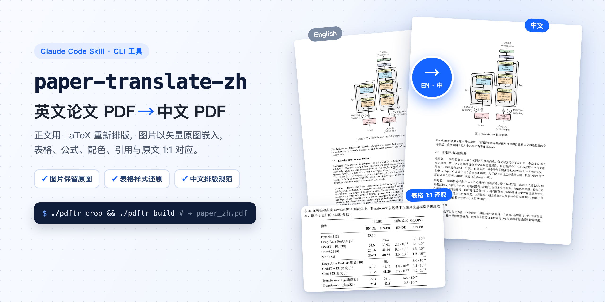

# paper-translate-zh



英文论文 PDF → 中文 PDF 的工具和 Claude Code 技能。正文用 LaTeX 重新排版，图片保留原始矢量图，只翻译图注。

```
paper-translate-zh/
├── SKILL.md                 技能说明（流程、原则、翻译约定、踩坑记录）
├── pdftr                    命令入口（自动使用 .venv）
├── requirements.txt
├── scripts/
│   ├── pdftr.py             工具本体：fonts / inspect / regions / extract / render / crop / build / preview
│   └── setup.sh             环境准备
├── templates/
│   ├── preamble.tex         LaTeX 导言区（ctex + TeX Gyre + 宋体，仿 ICLR 版式）
│   ├── main.tex             正文骨架
│   ├── project.example.json 工程配置示例
│   └── figtrans.example.py  图内翻译表示例（可选模式）
└── examples/2609.39045v1/   完整示例：RSIGame 论文（配置 + 全部 .tex 译文）
```

## 快速开始

```bash
./scripts/setup.sh                      # 建 venv、装依赖（需另装 tectonic：brew install tectonic）
cd examples/2609.39045v1
../../scripts/setup.sh project.json     # 抽取中文字体到 ../../fonts
../../pdftr crop && ../../pdftr build   # → work/2609.39045v1_zh.pdf
```

`examples/2609.39045v1/project.json` 原样复现了已交付的版本，那一版用了可选的图内翻译，所以先要 `pdftr extract && pdftr render`。
默认做法是**图不翻译**：把配置里的 `translate` 全部去掉，直接 `crop` + `build` 即可。

## 依赖

- Python 3.9+：pymupdf、fonttools、pillow
- tectonic（XeTeX，按需自动下载 TeX 宏包）
- 中文字体：默认从 macOS 自带的 `Songti.ttc` 抽取。其他系统可在 `project.json` 的 `font_files` 中指定 ttf/otf 路径，并把 `preamble.tex` 中的 CJK 字体名改成本机已有的字体。
