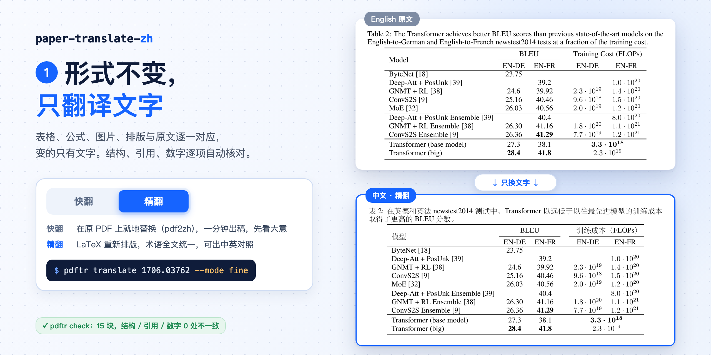
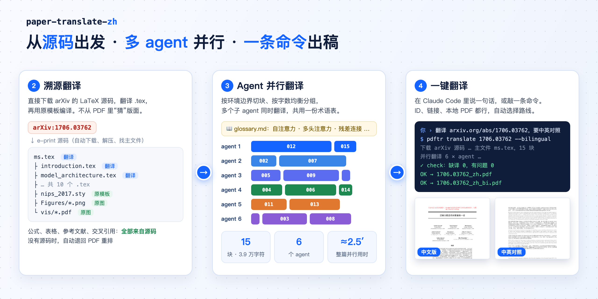

# paper-translate-zh





把英文论文翻译成中文 PDF 的 Claude Code 技能和命令行工具。**形式不变，只翻译文字**：表格、公式、图片、排版与原文逐一对应。

## 特点

1. **形式不变，两档可选**
   - 精翻（默认）：LaTeX 重新排版，术语全文统一，可同时输出中英对照版。
   - 快翻（`--mode quick`）：调用 [PDFMathTranslate](https://github.com/PDFMathTranslate/PDFMathTranslate) 在原 PDF 上就地替换，一两分钟出稿，适合先看大意。
2. **溯源翻译**：arXiv 论文直接下载 LaTeX 源码翻译。公式、表格、参考文献、交叉引用全部来自源码，再用原模板编译。没有源码时自动退回 PDF 重排流程。
3. **Agent 并行**：按 LaTeX 环境边界切块、按字数均衡分组，多个子 agent 共用一份术语表同时翻译。也可以用 API 引擎（Anthropic 或任意 OpenAI 兼容端点）并发翻译。
4. **一键翻译**：给 arXiv ID、链接或本地 PDF 都行，在 Claude Code 里说一句话，或者敲一条命令。
5. **自动质检**：逐块比对 LaTeX 结构、引用键和数字，再把成品与原 PDF 对比，找出缺失的数字和漏译段落。
6. **图不翻译**：图片保留原图，只翻译图注。

## 快速开始

```bash
git clone https://github.com/Grandahundo/paper-translate-zh.git
cd paper-translate-zh && ./scripts/setup.sh   # 建 venv、装依赖；另需 tectonic：brew install tectonic

./pdftr translate 1706.03762 --bilingual         # 精翻：下载源码、切块，打印并行分组
./pdftr translate paper.pdf --mode quick         # 快翻
```

在 Claude Code 中使用时，把本目录放到 `~/.claude/skills/paper-translate-zh`（或项目的 `.claude/skills/` 下），然后直接说“翻译 arxiv.org/abs/1706.03762，要中英对照”。剩下的流程（术语表、启动并行 agent、校验、编译）都写在 [SKILL.md](SKILL.md) 里。

不用 Claude 子 agent 时，可以用 API 引擎一条命令跑完：

```bash
ANTHROPIC_API_KEY=... ./pdftr translate 1706.03762 --engine api --workers 8 --bilingual
# 或任意 OpenAI 兼容端点：PDFTR_API_BASE / PDFTR_API_KEY / PDFTR_MODEL
```

## 命令一览

| 命令 | 作用 |
|---|---|
| `translate <输入>` | 一键入口：识别 arXiv ID，选择溯源翻译、PDF 重排或快翻 |
| `prep` / `batches` | 切块、统计术语候选、按字数给 N 个 agent 分组 |
| `run-api` | API 引擎并发翻译 |
| `check` | 逐块校验结构、引用、数字和漏译 |
| `assemble --build [--bilingual]` | 回填译文、编译中文版和中英对照版，并做成品质检 |
| `quick` / `qa-pdf` | 快翻；对任意两个 PDF 做数字和漏译质检 |
| `inspect` / `regions` / `crop` / `build` / `preview` | PDF 重排流程（没有源码时） |

## 实测

《Attention Is All You Need》（arXiv 1706.03762），见 [examples/1706.03762](examples/1706.03762)：

- 源码切成 15 块，共 3.9 万字符。
- 6 个子 agent 并行翻译，整篇约 2.5 分钟。
- `check` 报告结构、引用、数字 0 处不一致。
- 产出 14 页中文版和 17 页中英对照版。

## 目录

```
paper-translate-zh/
├── SKILL.md            技能说明：路线选择、溯源翻译、并行 agent、快翻、PDF 重排、翻译约定
├── pdftr               命令入口
├── scripts/
│   ├── pdftr.py        CLI：一键入口、快翻、质检、PDF 重排工具
│   ├── srcmode.py      溯源翻译：下载、预处理、切块、API 并行、校验、回填
│   └── setup.sh
├── templates/          翻译提示词、术语表模板、LaTeX 模板、工程配置示例
└── examples/           1706.03762（溯源翻译）、2609.39045v1（PDF 重排）
```

## 依赖

- Python 3.9+（pymupdf、fonttools、pillow）
- [tectonic](https://tectonic-typesetting.github.io)：XeTeX 引擎，按需自动下载宏包
- 快翻需要 `pdf2zh`；没有安装时自动用 `uvx` 临时运行，已固定兼容的依赖版本
- 中文字体：macOS 默认使用系统宋体；其他系统用 ctex 的 `fandol` 字体集（可以用 `--fontset` 指定）

图片使用的论文页面来自《Attention Is All You Need》（Vaswani et al., 2017）。Google 允许在注明出处的前提下，于学术作品中复制该论文的表格和图片。
